<div align="center">

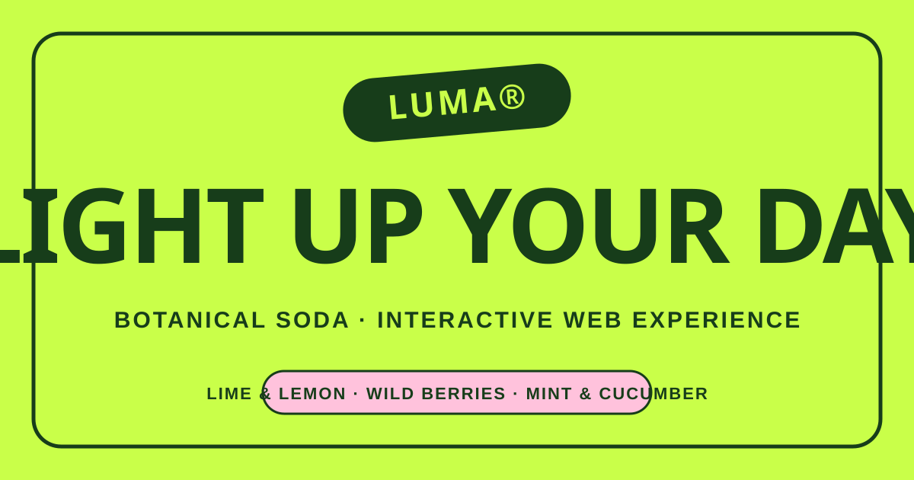

# LUMA — Botanical Soda Web Experience

**Zero dependencies. Zero build step. Zero audio files.**  
Pure HTML5, CSS3, and Vanilla JS — featuring a **106 BPM procedural Web Audio soundtrack**, **pure CSS soda can art**, **magnetic kinetic typography**, and **Solana Pay**.

<p align="center">
  <a href="https://annoris.github.io/luma/"></a>
  <a href="https://github.com/annoris/luma/stargazers"></a>
  <a href="SPONSORS.md"></a>
  
  
  
  <a href="SPONSORS.md"></a>
  <a href="LICENSE"></a>
</p>

<p align="center">
  <a href="https://annoris.github.io/luma/"><strong>🚀 Launch Live Demo</strong></a> &nbsp;&middot;&nbsp;
  <a href="#visual-tour"><strong>Visual Tour</strong></a> &nbsp;&middot;&nbsp;
  <a href="#brand-assets"><strong>Brand Assets</strong></a> &nbsp;&middot;&nbsp;
  <a href="#features"><strong>Features</strong></a> &nbsp;&middot;&nbsp;
  <a href="#architecture"><strong>Architecture</strong></a> &nbsp;&middot;&nbsp;
  <a href="#quick-start"><strong>Quick Start</strong></a> &nbsp;&middot;&nbsp;
  <a href="#licensing--solana-pay"><strong>Licensing &amp; Solana Pay</strong></a>
</p>

</div>

---

## 🎬 Live 60fps Interactive Walkthrough

<p align="center">
  <a href="https://annoris.github.io/luma/" target="_blank" rel="noopener noreferrer">
    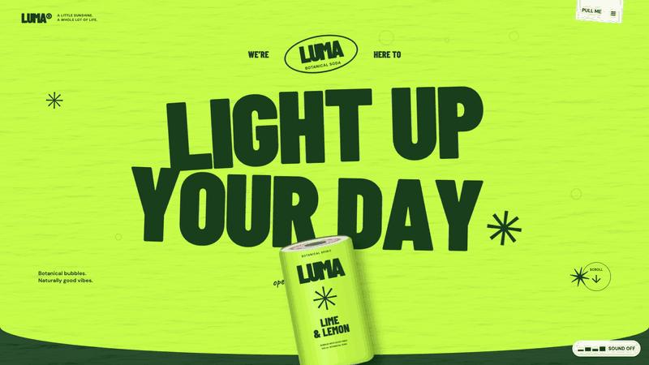
  </a>
</p>

<p align="center">
  <sub>👆 Click the walkthrough above to launch the live interactive <a href="https://annoris.github.io/luma/"><strong>LUMA Botanical Soda</strong></a> experience (106 BPM Web Audio synth · 3-flavor CSS soda can · scroll-driven storytelling · Solana Pay).</sub>
</p>

---

## Why LUMA?

Most interactive brand websites ship megabytes of bundled JavaScript, heavy 3D canvases, and licensed MP3 loops just to feel alive. **LUMA Botanical Soda** takes the opposite bet: an editorial, tactile, sun-drenched beverage showcase engineered with **0 npm packages**, **0 bundlers**, and **0 external audio files**.

Every detail — from the magnetic letterforms and tilted pure-CSS 330 ml soda can to the 122-line real-time Web Audio synthesizer and native Solana Pay checkout card — runs straight from static files at 60 fps and degrades gracefully when JavaScript or motion is disabled.

---

<a id="visual-tour"></a>
## Visual Website Tour

Explore all six live views of the **LUMA Botanical Soda** experience, captured directly from the running site across desktop and mobile viewports.

### 1. Hero — Open Your Sunny Side (`#inicio`)

<p align="center">
  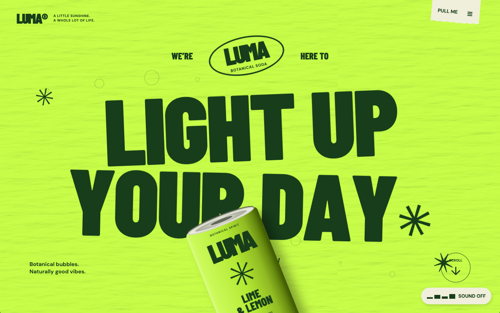
</p>

- **Magnetic Kinetic Typography:** The monumental `LIGHT UP YOUR DAY ✳` display headline splits into individual `.hero-letter` / `.hero-glyph` spans that respond smoothly to cursor proximity, subtle rotation, and scroll velocity while preserving a single clean `aria-label` for screen readers.
- **Pure-CSS 330 ml Soda Can:** Crafted entirely with CSS gradients, specular highlights, and layered rims — tilted dynamically via pointer coordinates (`--pointer-x`, `--pointer-y`) and scroll rotation (`--scroll-turn`).
- **Rising Botanical Bubbles & Pull-Tab Navigation:** Nine procedurally staggered bubbles drift behind the hero stage, paired with a tactile `PULL ME ☰` menu trigger in the header and a persistent `SOUND OFF / SOUND ON` floating Web Audio toggle.

---

### 2. The Spirit — Editorial Scrapbook & Infinite Marquee (`#nosotros`)

<p align="center">
  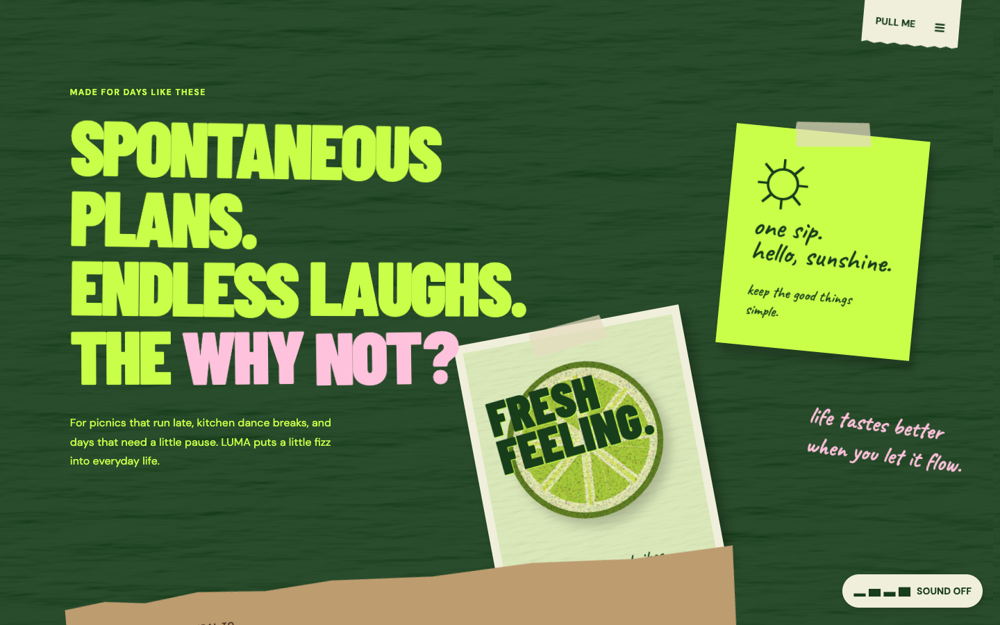
</p>

- **Tactile Paper & Scrapbook Composition:** Contrasts dark textured paper against bright lime sticky notes, masked tape strips, hand-drawn doodles, and kinetic word-reveal headings (`SPONTANEOUS PLANS. ENDLESS LAUGHS. THE WHY NOT?`).
- **Parallax Polaroid Citrus Card:** Features the custom `citrus-slice.svg` artwork inside a scroll-driven parallax frame (`data-parallax="0.07"`).
- **Torn-Paper Divider & Infinite Marquee:** Anchored by a high-contrast `IT’S ONLY NATURAL TO FEEL GOOD.` statement and a seamless CSS marquee ribbon chanting `LESS DRAMA. MORE BUBBLES. ✳`.

---

### 3. The Flavors — Interactive 3-Flavor Showcase (`#sabores`)

<p align="center">
  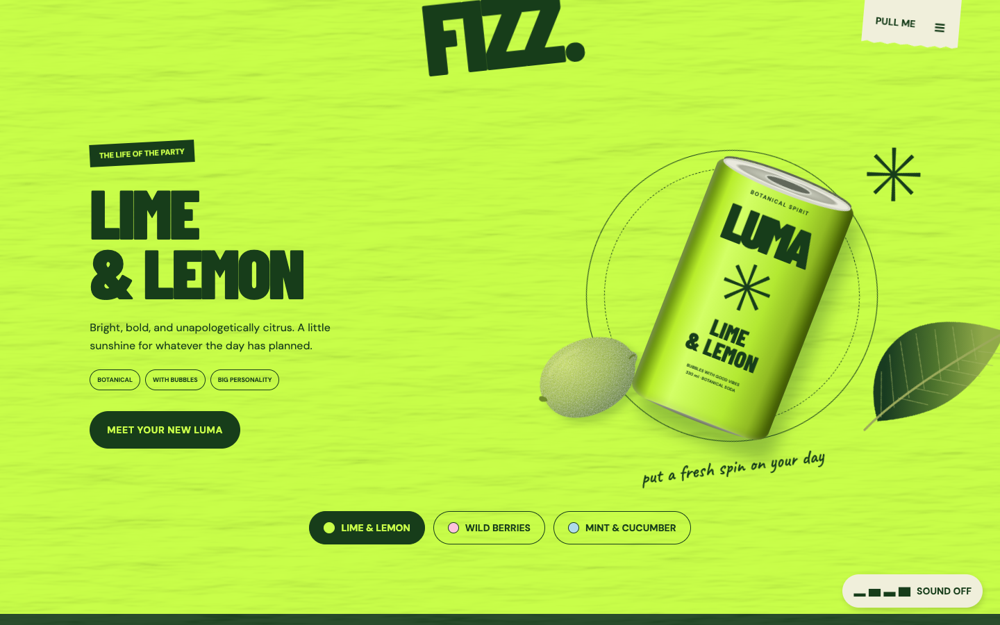
</p>

- **Live Theme & Can Switcher:** Clicking between **LIME & LEMON**, **WILD BERRIES**, and **MINT & CUCUMBER** (`data-flavor="citrus" | "berry" | "mint"`) instantly updates the flavor story, color palette, `aria-pressed` states, and the pure-CSS soda can label with a spring-eased Web Animations API transition.
- **Botanical Stage Art:** Pairs the display can with layered vector props (`botanical-leaf.svg` and `citrus-whole.svg`) and editorial sticker badges (`THE LIFE OF THE PARTY`).

| Flavor | Theme Key | Tasting Note |
| :--- | :--- | :--- |
| **Lime & Lemon** | `citrus` | Bright citrus, a botanical twist, and a little sunshine for whatever the day brings. |
| **Wild Berries** | `berry` | Wild berries, hibiscus, and light bubbles. A delicious little plot twist for your day. |
| **Mint & Cucumber** | `mint` | Lime, cucumber, and fresh mint. Take a breath, crack open a LUMA, and begin again. |

---

### 4. Your Moments — Scroll-Driven Storytelling Timeline (`#momentos`)

<p align="center">
  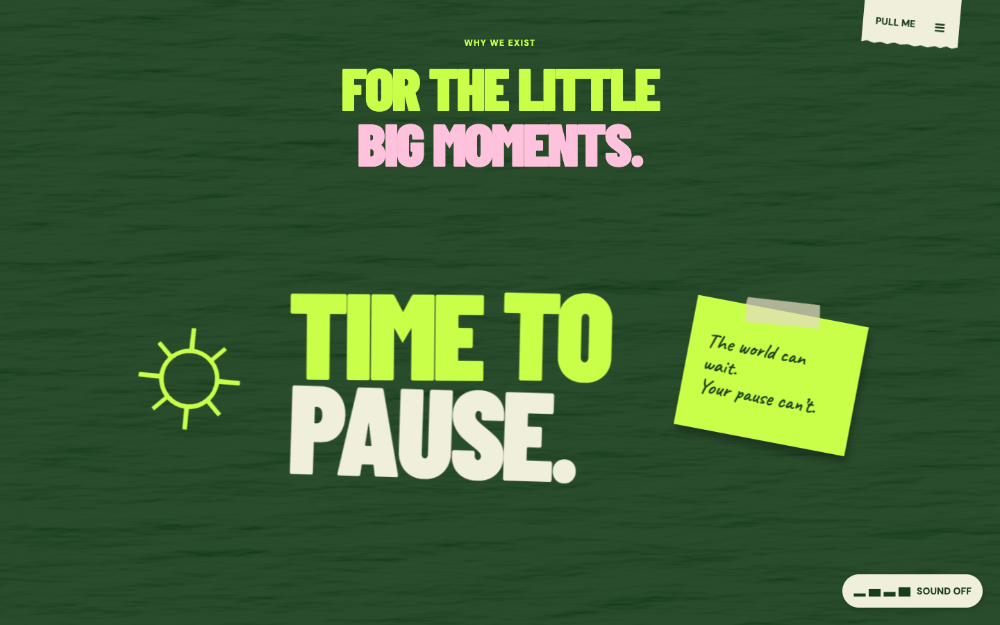
</p>

- **Sticky Scroll-Pinned Choreography:** On desktop viewports (`min-width: 801px`), `animations.js` elevates the three `.moment-row` chapters into a scroll-progress timeline (`--story-progress`, `--panel-offset`, `--panel-opacity`, `--panel-rotate`) so each card sweeps cleanly across the viewport.
- **Three Brand Chapters:** Moves through **`TIME TO PAUSE.`** (lime note), **`MADE TO SHARE.`** (pink note), and **`FREE TO FLOW.`** (blue note), each with opposite-direction parallax notes and progressive fallback to stacked cards on mobile or when `prefers-reduced-motion` is enabled.

---

### 5. Say Hello & Solana Payments / Commercial Licensing (`#contacto` & `#licensing`)

<p align="center">
  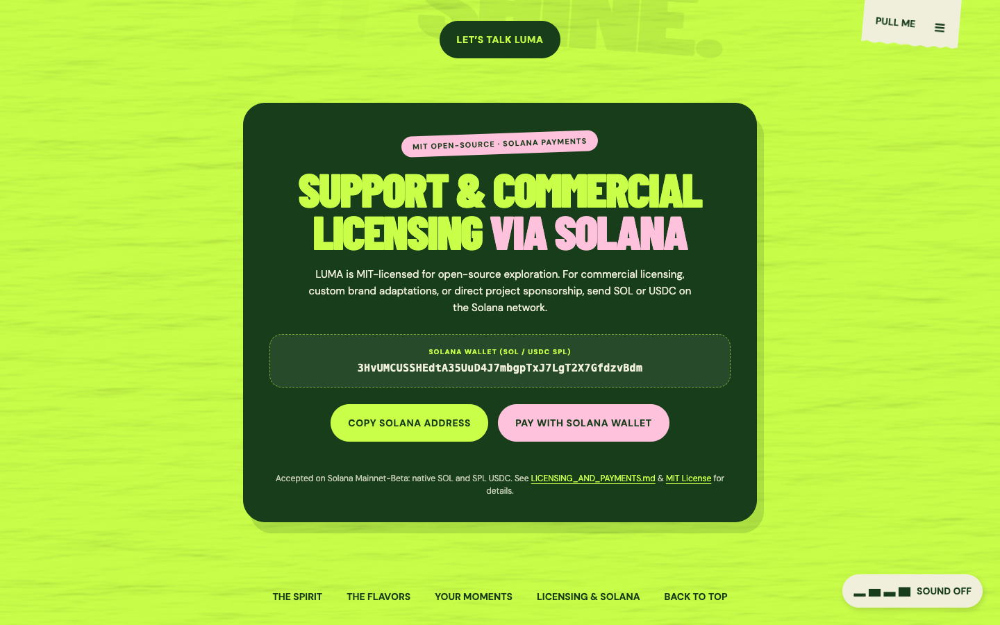
</p>

- **Interactive Demo CTA:** The `LET’S TALK LUMA` button toggles a live status confirmation (`role="status"`) for instant interactive feedback without requiring a backend form server.
- **Built-In Solana Pay Card (`#licensing`):** Displays the official Solana Mainnet wallet (`3HvUMCUSSHEdtA35UuD4J7mbgpTxJ7LgT2X7GfdzvBdm`), a **one-click `COPY SOLANA ADDRESS`** button (modern Clipboard API + legacy `execCommand` fallback + `aria-live="polite"` feedback), and a direct **`PAY WITH SOLANA WALLET`** button using the `solana:` URI scheme for Phantom, Solflare, Backpack, and Glow.

---

### 6. Mobile Responsive Experience (`390×844` @2x)

<p align="center">
  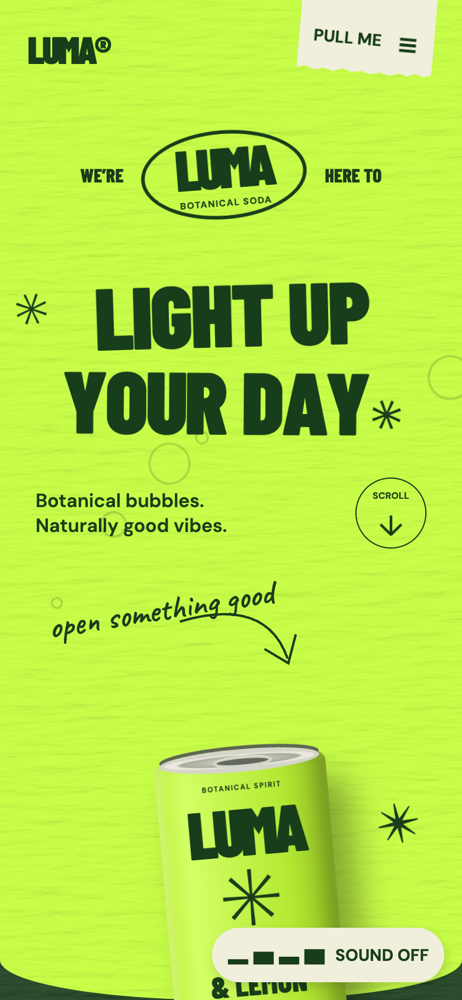
</p>

- **Thumb-First Ergonomics:** Clean fluid typography, stacked hero hierarchy, full-width touch targets, and a floating bottom audio toggle that never obscures navigation.
- **Accessible Pull-Tab Drawer:** Opening the `PULL ME ☰` menu locks background interaction via `inert` on `<main>` and `#sound-toggle`, traps keyboard `Tab` / `Shift+Tab` focus, and closes cleanly on `Escape` or link selection.

---

<a id="brand-assets"></a>
## Complete Brand & Vector Asset Gallery

Every vector asset in `assets/images/` is handcrafted, lightweight SVG — zero raster bloat, razor-sharp on Retina and 4K displays.

| Preview | Asset Path | Purpose & Usage |
| :---: | :--- | :--- |
|  | [`assets/images/og-preview.svg`](assets/images/og-preview.svg) | **Social OpenGraph & Twitter Card (`1200×630`)** — Featured in `og:image`, `twitter:image`, and this README hero banner. |
|  | [`assets/images/favicon.svg`](assets/images/favicon.svg) | **Brand SVG Favicon** — Crisp scalable browser tab icon linked in `index.html`. |
| 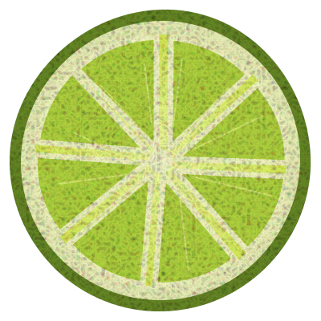 | [`assets/images/citrus-slice.svg`](assets/images/citrus-slice.svg) | **Scrapbook Citrus Slice Illustration** — Centerpiece inside the parallax polaroid card in `#nosotros`. |
|  | [`assets/images/botanical-leaf.svg`](assets/images/botanical-leaf.svg) | **Flavor Stage Botanical Leaf** — Layered botanical prop framing the display soda can in `#sabores`. |
| 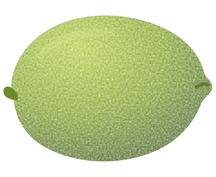 | [`assets/images/citrus-whole.svg`](assets/images/citrus-whole.svg) | **Flavor Stage Whole Citrus** — Companion vector accent positioned beside the interactive flavor can in `#sabores`. |

---

<a id="features"></a>
## Why Developers Love LUMA

- **0 npm dependencies & 0 build step:** Open `index.html` or run `npm start` — no Webpack, no Vite, no `node_modules` folder, no lockfile churn.
- **122-Line Procedural Web Audio Synthesizer (`assets/js/soundtrack.js`):** Synthesizes an original **106 BPM** lo-fi botanical groove entirely in the browser using `AudioContext`, `OscillatorNode`, `BiquadFilterNode`, `DynamicsCompressorNode`, and deterministic PRNG shaker noise. Includes smooth fade-in/fade-out gain ramps and automatic pause on `visibilitychange` when switching tabs.
- **Pure-CSS Soda Can Illustration:** The 330 ml hero and product-stage cans are rendered 100% in CSS — dynamically re-themed across all three flavors without swapping heavy PNGs.
- **Progressive Enhancement & Accessibility First (`assets/css/accessibility.css`):** Full `prefers-reduced-motion` support, skip-to-content link, semantic landmarks, `aria-pressed` / `aria-expanded` / `aria-live` states, `inert` modal isolation, and keyboard focus trapping.
- **Built-In Static Validator (`scripts/validate.mjs`):** Automatically verifies unique HTML IDs, all local `href` / `src` references, internal `#anchor` targets, and JavaScript syntax via `node --check` in CI.

---

<a id="architecture"></a>
## Architecture

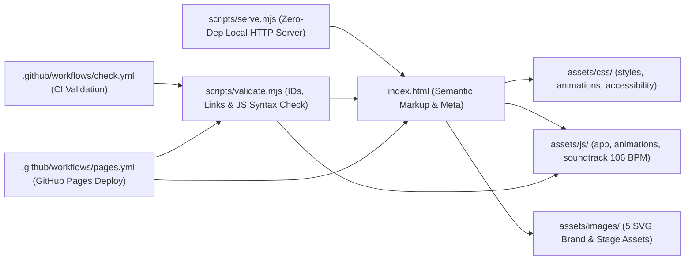

### Project Structure

```text
luma/
├── index.html                        # Semantic HTML5 entry point, OpenGraph meta, & all 5 sections
├── package.json                      # Zero dependencies; Node >=18 scripts (start, check) & Solana funding
├── LICENSE                           # Proprietary / All Rights Reserved (Copyright (c) 2026 LUMA Studio)
├── SPONSORS.md                       # Hall of Patrons & Solana sponsorship guide
├── CONTRIBUTING.md                   # Contribution workflow & standards
├── CODE_OF_CONDUCT.md                # Community Code of Conduct
├── assets/
│   ├── css/
│   │   ├── styles.css                # Core layout, paper textures, pure-CSS soda cans, & Solana card
│   │   ├── animations.css            # Kinetic type, bubbles, marquee, parallax, & story choreography
│   │   └── accessibility.css         # Focus rings, skip link, high-contrast, & reduced-motion rules
│   ├── js/
│   │   ├── animations.js             # Scroll reveal, magnetic hero letters, story timeline, & menu trap
│   │   ├── soundtrack.js             # 122-line procedural 106 BPM Web Audio API synthesizer
│   │   └── app.js                    # Audio toggle, flavor label sync, demo CTA, & Solana clipboard copy
│   └── images/
│       ├── og-preview.svg            # 1200x630 OpenGraph / Twitter preview banner
│       ├── favicon.svg               # Scalable SVG brand favicon
│       ├── citrus-slice.svg          # Scrapbook polaroid citrus illustration
│       ├── botanical-leaf.svg        # Flavor stage botanical leaf prop
│       └── citrus-whole.svg          # Flavor stage whole citrus prop
├── scripts/
│   ├── serve.mjs                     # Lightweight Node.js static file server (default port 4173)
│   └── validate.mjs                  # Automated HTML anchor, asset, & JS syntax validator
├── docs/
│   ├── VIRAL_LAUNCH_KIT.md           # Ready-to-post launch copy for GitHub, X, Hacker News, & Product Hunt
│   └── screenshots/
│       ├── 01-hero.png               # Desktop Hero capture
│       ├── 02-spirit.png             # Desktop Spirit & Marquee capture
│       ├── 03-flavors.png            # Desktop Interactive Flavors capture
│       ├── 04-moments.png            # Desktop Scroll Storytelling capture
│       ├── 05-solana-licensing.png   # Desktop Contact & Solana Pay card capture
│       └── 06-mobile.png             # Mobile 390x844 @2x responsive capture
└── .github/
    ├── FUNDING.yml                   # GitHub Sponsor button configuration
    ├── ISSUE_TEMPLATE/               # Bug report & feature request templates
    ├── PULL_REQUEST_TEMPLATE.md      # Pull request checklist
    └── workflows/
        ├── check.yml                 # Runs `npm run check` on every push & PR
        └── pages.yml                 # Validates & deploys directly to GitHub Pages
```

---

<a id="quick-start"></a>
## Quick Start & Deployment

> [!IMPORTANT]
> **Proprietary Source Code — All Rights Reserved:**
> - **Live Flagship Showcase:** Anyone can experience the live 60fps production site & 106 BPM Web Audio synthesizer at **[https://annoris.github.io/luma/](https://annoris.github.io/luma/)** and inspect all 6 high-resolution section screenshots (`docs/screenshots/`) and 5 bespoke SVG illustrations (`assets/images/`) right here in this public showcase repository.
> - **Proprietary Source Code:** The underlying application source code (`index.html`, `assets/js/`, `assets/css/`, and `scripts/`) is proprietary software (`All Rights Reserved`). Commercial licensing and private deployment access are available exclusively through a direct written agreement with the author. See [`LICENSE`](./LICENSE) for full terms.

### Prerequisites
- **Node.js `>= 18`** (only needed for the built-in dev server and validator — no `npm install` required).

### Run Locally (Authorized Source Access)

```bash
# Start the zero-dependency local server (http://127.0.0.1:4173)
npm start

# Optional: run on a custom port
PORT=8080 npm start
```

### Run Automated Checks

```bash
npm run check
```

Verifies that all HTML IDs are unique, every local `src`/`href` asset and internal `#anchor` resolves, and every JavaScript file passes `node --check`.

---

<a id="licensing--solana-pay"></a>
## Licensing & Solana Payments

### Proprietary License — All Rights Reserved
This project is distributed under the [**Proprietary / All Rights Reserved License**](LICENSE) (`Copyright (c) 2026 LUMA Studio`). Commercial use and source code licensing are available exclusively through a direct written agreement with the author. See [**`SPONSORS.md`**](SPONSORS.md) for voluntary sponsorship details.

### Scan to Sponsor with Any Solana Wallet (`SOL`)

<div align="center">

<a href="https://solscan.io/account/3HvUMCUSSHEdtA35UuD4J7mbgpTxJ7LgT2X7GfdzvBdm">
  
</a>

<br />

```text
3HvUMCUSSHEdtA35UuD4J7mbgpTxJ7LgT2X7GfdzvBdm
```

<p>
  <strong>1-Step Sponsorship:</strong> Scan the QR code above with Phantom, Solflare, Backpack, Coinbase, Binance, or Trust Wallet (or copy the Solana address above) to send <strong>SOL</strong> directly.
</p>

</div>

| Field | Details |
| :--- | :--- |
| **Network** | **Solana Mainnet-Beta** (`SOL` & `USDC` SPL) |
| **Wallet Address** | `3HvUMCUSSHEdtA35UuD4J7mbgpTxJ7LgT2X7GfdzvBdm` |
| **Block Explorer** | [View on Solscan](https://solscan.io/account/3HvUMCUSSHEdtA35UuD4J7mbgpTxJ7LgT2X7GfdzvBdm) |
| **License** | [Proprietary / All Rights Reserved](LICENSE) |

> **Network Notice:** Send **SOL** or **SPL USDC** strictly on the **Solana Mainnet** network. Do not send assets over Ethereum (ERC-20), Polygon, Arbitrum, Base, or BNB Smart Chain.

---

<a id="viral-launch-kit"></a>
## Community, Contributions & Viral Launch Kit

Love zero-dependency creative coding? Help LUMA reach more builders and designers:

- **Star this repo ⭐** at the top right of GitHub if pure HTML5/CSS3/Vanilla JS craft makes you smile!
- **Read the Launch Kit:** Grab ready-to-share posts, hooks, and showcase assets in [**`docs/VIRAL_LAUNCH_KIT.md`**](docs/VIRAL_LAUNCH_KIT.md).
- **Contribute:** Check out [**`CONTRIBUTING.md`**](CONTRIBUTING.md) and our [**`CODE_OF_CONDUCT.md`**](CODE_OF_CONDUCT.md) before opening a PR or issue.

<p align="center">
  <a href="https://twitter.com/intent/tweet?text=Zero%20dependencies.%20Zero%20build%20step.%20Zero%20audio%20files.%20Check%20out%20LUMA%20Botanical%20Soda%20%E2%80%94%20pure%20HTML5%2C%20CSS3%2C%20Vanilla%20JS%2C%20a%20106%20BPM%20Web%20Audio%20synth%2C%20pure%20CSS%20soda%20can%20art%2C%20and%20Solana%20Pay%20%E2%9C%B3%EF%B8%8F">
    
  </a>
</p>

---

<div align="center">
  <sub>Made with sunshine, botanical bubbles, and zero dependencies by <strong>LUMA Studio</strong> · <a href="LICENSE">Proprietary / All Rights Reserved</a></sub>
</div>

---

## 🌐 Explore the JAP INTERNATIONAL & Annoris Ecosystem

Built by **JAP INTERNATIONAL** — Local-First AI Automation Platforms for Small & Medium Businesses (SMBs), agencies, clinics, e-commerce, and enterprise teams, alongside 60 FPS Creative Web Engineering showcases. Every project below includes an instant **Live Demo (zero login required)**.

### 🤖 AI & Local-First Business Automation
| Project | What It Solves | Stack | Live Demo |
| :--- | :--- | :--- | :---: |
| [**`aetheris`**](https://github.com/annoris/aetheris) | 77 AI Agents, 328 Skills & Local-First Automation Control Plane | Bun · Node · Ollama · MCP | [Live Demo ↗](https://annoris.github.io/aetheris/) |
| [**`aurelia`**](https://github.com/annoris/aurelia) | Self-Hosted Business AI Automation, RAG, Workflows & Local CRM | React 18 · Express · Prisma | [Live Demo ↗](https://annoris.github.io/aurelia/) |
| [**`lumenpitch`**](https://github.com/annoris/lumenpitch) | AI Presentation Studio & Multi-LLM Slide Generation Engine | Next.js 16 · FastAPI · Electron | [Live Demo ↗](https://annoris.github.io/lumenpitch/) |
| [**`tabvento`**](https://github.com/annoris/tabvento) | Autonomous AI Browser Automation Dashboard (Local-First BYOK) | Python · Playwright · SQLite | [Live Demo ↗](https://annoris.github.io/tabvento/) |
| [**`trading-bauhaus-journal`**](https://github.com/annoris/trading-bauhaus-journal) | AI Trading Journal with Claude/OpenAI Analyst & OHLC Replay | Next.js 15 · TypeScript · SQLite | [Live Demo ↗](https://annoris.github.io/trading-bauhaus-journal/) |

### 🎨 Creative Engineering & 60 FPS Web Showcases
| Project | Experience & Motion Engineering | Stack | Live Demo |
| :--- | :--- | :--- | :---: |
| [**`kairo`**](https://github.com/annoris/kairo) | 60 FPS Spatial Web: Navier-Stokes Fluid, GLSL Shaders & Rapier 3D | Next.js 14 · Three.js · GLSL | [Live Demo ↗](https://annoris.github.io/kairo/) |
| [**`valence`**](https://github.com/annoris/valence) | Zero-Bundler 60 FPS Awwwards Agency Template (MIT) | HTML5 · CSS3 · GSAP · Lenis | [Live Demo ↗](https://annoris.github.io/valence/) |
| **`luma`** *(You are here)* | Zero-Dependency Botanical Brand Experience + 106 BPM Web Audio Synth | HTML5 · CSS3 · Web Audio API | [Live Demo ↗](https://annoris.github.io/luma/) |
| [**`valtor`**](https://github.com/annoris/valtor) | Luxury Automotive Digital Flagship — 60 FPS GSAP + SplitText | Vite · ES Modules · GSAP | [Live Demo ↗](https://annoris.github.io/valtor/) |
| [**`solterra`**](https://github.com/annoris/solterra) | Luxury Desert Architecture Showcase — GSAP ScrollSmoother | React 19 · Vite 6 · Tailwind 4 | [Live Demo ↗](https://annoris.github.io/solterra/) |
| [**`moxie`**](https://github.com/annoris/moxie) | Bold Social-First Creative Agency Experience — GSAP Inertia | Next.js 15 · React 19 · Lenis | [Live Demo ↗](https://annoris.github.io/moxie/) |
| [**`kineta`**](https://github.com/annoris/kineta) | Locked-60fps Brutalist Editorial Showcase & Variable Font Physics | Vanilla JS · GSAP · Lenis | [Live Demo ↗](https://annoris.github.io/kineta/) |
| [**`solmora`**](https://github.com/annoris/solmora) | Editorial Mediterranean E-Commerce Showcase (MIT, Zero-Deps) | HTML5 · CSS3 · Vanilla JS | [Live Demo ↗](https://annoris.github.io/solmora/) |

> ⭐ **Enjoyed exploring this project?** Drop a **Star** on GitHub and check out the full portfolio at [**github.com/annoris**](https://github.com/annoris) — it helps other builders discover the ecosystem!
